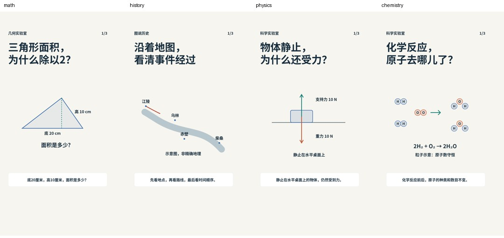

# 制作模板

模板负责建立可预览的工程和数据接口，不代替数学解题、历史资料核对或实验条件判断。四个JSON是示例选题，创建后必须按真实选题替换。

```bash
npm run new:video -- MyMath --subject math
npm run new:video -- MyHistory --subject history
npm run new:video -- MyPhysics --subject physics
npm run new:video -- MyChemistry --subject chemistry
```

生成：`src/videos/<slug>/content.json`、`runtime.json`、`Diagram.tsx`、`Registration.tsx`，以及 `public/assets/<slug>/audio/`；自动登记Studio、Actions和README。

- `content.json`：选题、品牌、字幕、配音文案、计划分镜、模型输入、来源。结构见 `schemas/content.schema.json`；字幕短句，最多两行，配音独立保存自然读法。
- `Diagram.tsx`：本题的图形/地图/实验模型。初始组件提供三角形、地图路线、受力图、粒子守恒示例；历史复杂地图以 `ChibiMapFull` 的SVG world为参考。不要把多步解释只做成文字卡片。
- `runtime.json`：生成时标记 `timingMode: planned`，只用于版式预览。真实配音完成后改为 `measured`，以实测音频安排字幕与动画。正式渲染会拒绝没有实测配音或文案与缓存时间轴不一致的草稿。改稿后重新生成或用--cached-only重新计时。
- `Registration.tsx`：独立视频和封面注册，保留唯一ID；`src/videos/registered.tsx`由登记表生成。

先建立模型断言，再生成声音。`npm run voice:case -- MyMath` 生成逐句音频；已有相同文本、声音与语速的缓存会复用。每镜时长为 `max(计划秒数, 0.3 + 所有配音时长 + 句间停顿 + 0.5)`，向上对齐30fps。语速超4.8字/秒会提示；文案不变而时长超标时明确报告，不能偷偷改变目标。

成功案例参考：

| 类型 | 参考 | 保留/复用的重点 |
| --- | --- | --- |
| 格子与立体计数 | `MathExplainer` | 数据计数、逐层分解、重叠剔除、独立验算 |
| 小学奥数几何 | `TrapezoidExplainer` | 画图断言、辅助线、隐藏图形、一步一结论 |
| 历史地图推演 | `ChibiMapFull` | 地理关系、摄像机、路径切线、运动军队、确定性火势 |
| 物理 | `physics.json` | 对象、条件、方向、量纲、坐标轴 |
| 化学 | `chemistry.json` | 原子/电荷守恒、计量系数、状态和反应条件 |

现有案例继续使用各自数据和配音脚本，不为统一格式重做成功的视频。后续题材只共用底座，复杂图形仍需题材专用代码。

## 起步模板画面

以下是模板样例，不是新选题的正式成片：


